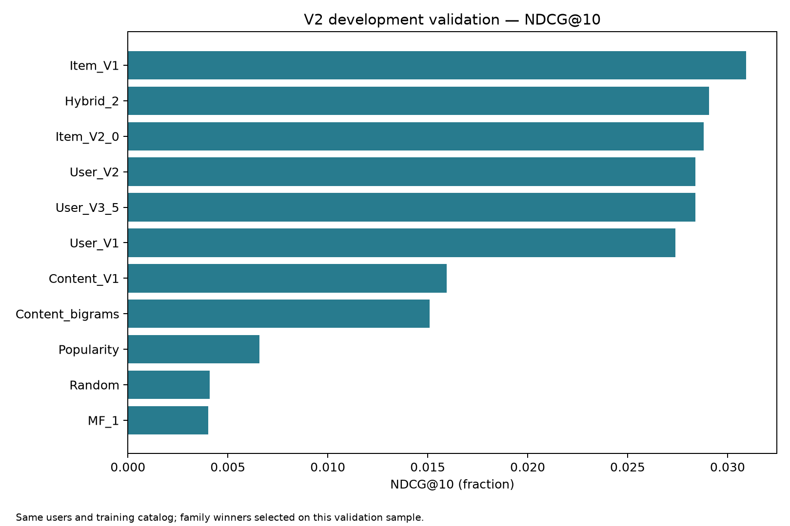
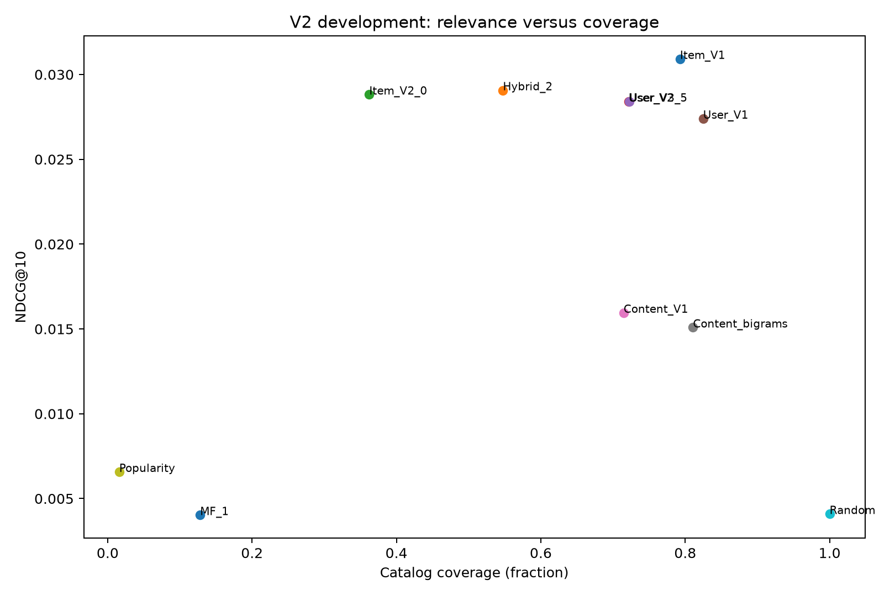

# ShopSmart — Intelligent E-commerce Recommendations

## Project overview

ShopSmart is an academic machine learning project for personalized electronics
recommendations, with a Black Friday shopping use case. It combines content-based,
neighborhood and latent-factor methods, compares them on a shared chronological
benchmark, and adds an optional local retrieval-augmented generation (RAG) demo.
It does not provide current shopping offers or measured commercial uplift.

## Problem statement

Given a user's earlier product ratings, rank unseen products that match their
later positive feedback. Compare recommendation quality, catalog coverage and
diversity, and study how sparse evidence, selection bias and model complexity
affect the results. Natural-language discovery and explanations complement this
ranking task through the optional RAG extension.

## Dataset

[Amazon Reviews 2023 — Electronics](https://amazon-reviews-2023.github.io/),
McAuley Lab. The supplied rating CSV contains 15,473,536 interactions. Product
metadata include titles, categories, features and descriptions.

The development benchmark contains **5,000 users, 999 products and 53,152 training
ratings**. There are 2,336 later unseen in-catalog ratings. Ranking evaluates a
shared sample of 1,000 users with at least one positive in-catalog target.
Raw and processed datasets and serialized models stay local; download the source
from the official dataset site to reproduce preparation in a fresh checkout.

## Project workflow

1. **Explore:** notebook 01 examines ratings, activity, sparsity and metadata.
2. **Prepare:** notebook 02 records the initial preparation; `src/data/prepare.py`
   reconstructs a stricter globally chronological benchmark from raw data.
3. **Implement:** notebooks 03–04 introduce content-based and collaborative KNN;
   notebook 05 preserves the original comparison.
4. **Optimize and compare:** notebooks 06–08 analyze shared-validation experiments,
   observed-rating matrix factorization and hybrid rank fusion.
5. **Demonstrate:** the recommendation CLI compares saved models; notebook 09 and
   the RAG CLI show catalog search and evidence-based language generation.

All eight existing notebooks and recorded ML results are preserved. Original
notebook results are labelled historical; their evaluation protocol differs from
the later shared benchmark. The sequence records both development and refinement.

## Recommendation algorithms

- Popularity and deterministic random baselines.
- TF-IDF content profiles; field weighting, bigrams, rating-strength weighting,
  negative preferences and maximal marginal relevance (MMR) variants.
- User-based KNN: original, support-regularized and overlap/shrinkage/centering variants.
- Item-based KNN: sparse precomputed neighbors, overlap/shrinkage, score normalization.
- Biased matrix factorization: minibatch SGD on **observed ratings only**, with
  validation-RMSE early stopping. Missing ratings are not zero training targets.
- Hybrid reciprocal rank fusion (RRF), with validation-selected component weights
  and explicit missing-score/popularity fallback behavior.

## Experimental methodology

Catalog and user eligibility use only interactions **before 2020-01-01 UTC**.
Training uses those interactions; development validation covers 2020–2021.
The 1,000-product popularity cap and deterministic 5,000-user cap yield 999
observed training-catalog products. Models share candidates, evaluation users
and exclusions of all previously rated items. Relevance is a held-out rating ≥4.

The bounded search contains 34 configurations. Primary selection is macro
**NDCG@10**, with Hit Rate@10 as the first tie-breaker. Metrics include precision,
recall and HR at 5/10, NDCG/MRR at 10, catalog coverage, list length and shared
TF-IDF diversity. RMSE/MAE apply only to MF. With one relevant target, Recall=HR
and Precision=HR/K; multiple-target evaluation uses their general definitions.
Unknown interactions are unjudged, not explicit negative feedback.

**There is no independent final-test claim.** The historical test was already
examined. User-bootstrap intervals and paired comparisons are descriptive and
do not remove validation-selection optimism. See the
[evaluation protocol](docs/evaluation_protocol.md) for complete definitions,
selection rules, cold-start behavior and methodological limitations.

## Results and discussion

Measured validation family winners, all on the same users and catalog:

| Model | HR@10 | NDCG@10 | Coverage |
| --- | ---: | ---: | ---: |
| Original item KNN, rerun on shared benchmark | **9.7%** | **0.03092** | 79.28% |
| Hybrid RRF | 9.4% | 0.02907 | 54.75% |
| Regularized item KNN | 9.1% | 0.02882 | 36.24% |
| User KNN V2 | 8.7% | 0.02840 | 72.17% |
| User KNN V3 | 8.7% | 0.02840 | 72.27% |
| Original user KNN | 7.0% | 0.02739 | 82.48% |
| Original TF-IDF | 5.4% | 0.01595 | 71.47% |
| Weighted bigram TF-IDF | 5.3% | 0.01509 | 81.08% |
| Popularity | 2.7% | 0.00657 | 1.60% |
| Random | 1.9% | 0.00409 | 100% |
| Matrix factorization | 1.5% | 0.00403 | 12.81% |

Item KNN achieves the best observed validation NDCG. More complex models do not
consistently improve ranking; stricter overlap can discard useful sparse signals,
while MMR trades accuracy for diversity. Selected MF has RMSE 1.12649 and MAE
0.73177 but weak ranking, illustrating the difference between the two objectives.
Several paired uncertainty intervals cross zero; no independent superiority is
established. Historical V1 and shared-benchmark scores are not directly comparable.





[All runs](reports/results/validation_all_runs.csv),
[selected results](reports/results/validation_selected.csv),
[paired comparisons](reports/results/paired_comparisons.csv),
[full-target recall](reports/results/full_target_recall.csv) and
[figure captions](reports/figures/README.md) preserve the experimental evidence.
A second full run reproduced all non-timing numeric results within 1e-12;
[the reproducibility record](reports/results/reproducibility_check.json) stores
that comparison. No experiments were rerun for the RAG/cleanup release.

## Minimal RAG extension

**Discovery:** TF-IDF/cosine retrieval searches existing titles, categories,
features and descriptions. The vectorizer and sparse matrix are cached under
`.cache/rag/`, with a catalog-content fingerprint that invalidates stale caches.
Invalid/missing IDs or titles are excluded; duplicate IDs use the first valid
record. Zero-overlap queries return no matches rather than arbitrary products.

**Recommendation explanation:** existing ML models select products for a user;
RAG looks up those exact IDs and explains their catalog metadata. ML ranking
scores remain separate from retrieval similarity and generated language. This
explains possible suitability, not the causal reasoning of the recommender.

A small adapter calls Ollama's local
[`POST /api/generate`](https://docs.ollama.com/api/generate) endpoint with retrieved
documents and a constrained JSON schema. Responses must reference retrieved IDs
and include an exact evidence quote. Output separates **catalog evidence**,
**inferred suitability** and **missing information**. Scores, prices and aggregate
review statistics are not supplied to the LLM. These checks support grounding;
they do not prove every free-text inference is correct.

Missing servers/models, timeouts and invalid evidence produce explicitly labelled
**retrieval-only** results. Those are not reported as generated RAG answers.
Both modes were exercised against the installed local `mistral:latest` model;
[discovery](reports/results/rag_live_demo.json) and
[recommendation explanation](reports/results/rag_explanation_live.json) record
the actual generated outputs. No vector database, external product API or
orchestration framework is required.

## Project structure

```text
notebooks/             01–09: exploration through RAG demonstration
src/data/              Raw-source chronological preparation
src/models/            Shared recommendation implementations
src/evaluation/        Ranking metrics, evaluation and bootstrap
src/rag/               Catalog index, Ollama adapter and evidence checks
scripts/               Experiment, recommendation, RAG and verification CLIs
tests/                 Synthetic/unit tests and optional prepared-data checks
docs/                  Technical evaluation and RAG usage documentation
reports/results/       Metrics, sample, hashes and reproducibility records
reports/figures/       Six measured-result figures and captions
data/                  Local raw/processed datasets (ignored)
artifacts/             Local saved ML models (ignored)
```

Redundant narrative drafts and old logs are archived locally under the ignored
`.local_archive/`; experimental tables, figures and scientific caveats are kept.

## Installation

Recorded environment: Ubuntu WSL2, Python 3.12.3. From the repository root:

```bash
python3 -m venv .venv
.venv/bin/python -m pip install -r requirements.txt
.venv/bin/python -m unittest discover -s tests -v
.venv/bin/python scripts/verify_project.py --recorded-only
```

RAG uses existing scikit-learn/joblib and Python's HTTP client; no extra Python
dependencies are needed. Tests mock Ollama and do not require a running LLM.
Prepared-data tests skip explicitly when local data are absent.

## How to reproduce experiments

Place `Electronics.csv.gz` and `meta_Electronics.jsonl.gz` under `data/raw/`.
The much larger review-text JSONL is not needed. Then:

```bash
.venv/bin/python -m src.data.prepare
OPENBLAS_NUM_THREADS=1 OMP_NUM_THREADS=1 .venv/bin/python scripts/run_experiments.py
.venv/bin/python scripts/verify_project.py
```

Preparation streams three rating scans and one metadata scan. The bounded grid
runs on a CPU laptop; no GPU is required. Generated data/model files are ignored.
Changing preparation caps or `--sample-size` changes the benchmark. Experiment
reruns write result files; use a separate checkout/copy to retain a recorded run.
New analysis notebooks reuse the saved runs and models:

```bash
OPENBLAS_NUM_THREADS=1 .venv/bin/python scripts/execute_analysis_notebooks.py
```

Historical notebooks use the original `data/processed/` files. Reconstruct those
by running notebooks 01–02 from `notebooks/` before optional replay:

```bash
OPENBLAS_NUM_THREADS=1 .venv/bin/python scripts/reproduce_v1.py
```

The replay recreates the original shared test sample only when absent. After
that, notebooks 03–05 can run in order; this resolves their shared-sample file
dependency without changing historical notebook cells.

## How to run recommendations

After preparing data and running experiments:

```bash
.venv/bin/python scripts/demo.py
.venv/bin/python scripts/demo.py --list-users
.venv/bin/python scripts/demo.py --user USER_ID --models Item_V1 Hybrid_2 Popularity
.venv/bin/python scripts/demo.py --user unknown-user
```

The CLI shows rated history, product names/categories and ranking scores.
Previously rated items are excluded; unknown users receive training popularity.

## How to run the RAG demo

RAG needs an existing product catalog. It defaults to
`data/processed/v2/products.jsonl`, then the original prepared catalog files.
Alternatively pass `--catalog PATH` to your Amazon product JSONL. Discovery does
not require the trained ML bundle.

```bash
.venv/bin/python scripts/rag_demo.py  # Type a request interactively
.venv/bin/python scripts/rag_demo.py --query "Recommend a monitor for office work." --retrieval-only
.venv/bin/python scripts/rag_demo.py --query "I need wireless headphones." --model mistral:latest
.venv/bin/python scripts/rag_demo.py --user USER_ID --top-k 3
.venv/bin/python scripts/rag_demo.py --check-ollama
OPENBLAS_NUM_THREADS=1 .venv/bin/python scripts/execute_analysis_notebooks.py --rag
```

Install Ollama following its [Linux instructions](https://docs.ollama.com/linux),
start `ollama serve`, and inspect `ollama list`. Choose an already downloaded local
model with `--model` or `OLLAMA_MODEL`. When unset, the adapter chooses the smallest
installed local model reported by the server. No model is downloaded automatically.
`--host` / `OLLAMA_HOST` configures the server (default `http://localhost:11434`);
`--timeout` configures the request timeout. See [RAG setup](docs/rag.md) for model
installation, WSL networking and the actual live verification status.

## Limitations and future work

The benchmark conditions on active users and a popular frozen catalog: **89.8%
of later positive pairs lie outside it**. Only 1,139 of 3,095 users with later
positives qualify for ranking evaluation. Results do not describe the entire
Electronics catalog. Other limits include metadata snapshots from later dates,
parent-ASIN changes, one temporal window/seed, bounded tuning, unknown feedback
and representation-based diversity. Cold items lack learned personalized factors;
unknown users receive popularity. An independent final test is unavailable.

RAG retrieval is lexical, not a tested semantic relevance model. A language model
can still make weak inferences despite citation checks; human review is needed.
Descriptions and prices are historical, with no current stock or discounts.
RAG has functional tests and demonstrations, not a benchmark of answer quality.
Future work includes protected temporal holdouts, ranking-oriented factorization,
new-item onboarding and a separate item-weight ablation. MLOps, MLflow, Docker,
FastAPI and a complex frontend are outside this release.

## Dataset attribution

Hou, Y., Li, J., He, Z., Yan, A., Chen, X., and McAuley, J. (2024).
*Bridging Language and Items for Retrieval and Recommendation*.
[arXiv:2403.03952](https://arxiv.org/abs/2403.03952).
Use the [official dataset site](https://amazon-reviews-2023.github.io/) for access,
usage terms and source information. Raw datasets and downloaded model weights
are not redistributed by this repository.
